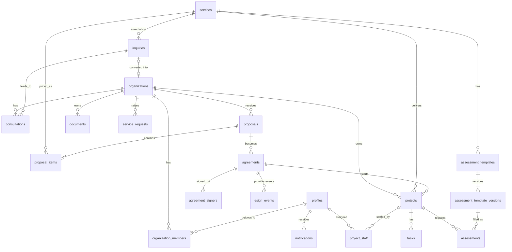

# Atlas Advisory CEMS — Proposed Design (v0.1, for review)

Status: **awaiting owner approval. No code has been written.**

How to read this: each section starts with a plain-language summary, then the detail. Section 8 lists the decisions I need from you.

---

## 1. System architecture

**In plain language:** we build *one* application, not several. It has three "front doors" (public website, client portal, admin area) that share one database. Inside, the code is split into folders by business topic (inquiries, proposals, agreements…), so each topic can be built and changed on its own. This is what "modular monolith" means: one app to deploy, many tidy rooms inside.

```
Visitor ──► Public site ─┐
Client  ──► Client portal ├─► Next.js app on Vercel ──► Supabase
Staff   ──► Admin area  ──┘     (server-side code)       ├─ Postgres + RLS (data)
                                     ▲                   ├─ Auth (logins, MFA)
E-sign provider ── webhook ──────────┘                   └─ Storage (private files)
```

### 1.1 The three front doors

| Area | URL | Who | Login |
|---|---|---|---|
| Public website | `/`, `/about`, `/services`, `/contact`, `/inquiry`, `/consultation` | Anyone | None |
| Client portal | `/portal/...` | CLIENT_OWNER, CLIENT_MEMBER | Email + password, invite only |
| Admin | `/admin/...` | Atlas staff | Email + password + MFA code |

### 1.2 Code layout

```
cems/
  src/
    app/
      (public)/        public pages and forms
      portal/          client portal pages
      admin/           staff pages
      api/webhooks/    e-sign provider callback
    modules/           one folder per business topic
      inquiries/  organizations/  consultations/  proposals/
      agreements/  assessments/  documents/  projects/
      notifications/  audit/
        each contains: actions.ts (changes), queries.ts (reads),
                       schema.ts (input validation), components/
    lib/               supabase clients, auth helpers, shared UI
  supabase/
    migrations/        every database change, as a versioned SQL file
    seed.sql           fake data only
    tests/             cross-organization access tests
```

Rule: a module only talks to another module through its `actions.ts` / `queries.ts`, never by reaching into its internals.

### 1.3 Two layers of permission checks

Every request is checked twice, on purpose:

1. **Server code** checks "is this user allowed to do this?" before doing anything.
2. **The database itself** (Row Level Security, RLS) refuses to return or change rows the user has no right to — even if the server code has a bug.

Think of it as a receptionist (server code) plus a locked filing cabinet (RLS). A mistake by the receptionist does not open the cabinet.

### 1.4 Environments

| Environment | Purpose | Data |
|---|---|---|
| `atlas-dev` (Supabase project) + Vercel preview | Building and testing | Fake data only |
| `atlas-prod` (Supabase project) + Vercel production | Real use | Real data |

Production deploys happen only when you approve. Database changes are SQL migration files in GitHub, so every change is reviewable and repeatable.

---

## 2. Entity relationship diagram

**In plain language:** this is the map of what the system stores and how the pieces connect. Read `||--o{` as "one … has many …".



Not drawn (they attach to anything): `internal_notes` and `audit_log`.

The lifecycle as data:

```
inquiry ─(staff qualifies)─► organization + invited client user
   └► consultation ─► proposal ─(client accepts)─► agreement ─(provider confirms signature)─►
      project [pre_assessment] ─► assessment approved ─► [onboarding] ─(staff starts)─► [in_delivery]
```

Each arrow marked with a person is a **manual** step. Nothing jumps forward on its own (business rules 2, 3, 7).

---

## 3. Table definitions

Every table has `id` (uuid), `created_at`, `updated_at`. Every table has RLS switched on. "Org-scoped" means the row carries `organization_id` and clients only see rows of their own organization.

### People and organizations

| Table | Key columns | Notes |
|---|---|---|
| `profiles` | `id` (= login id), `full_name`, `phone`, `staff_role` (SUPER_ADMIN / ADMIN / PROJECT_COORDINATOR / CONSULTANT / null), `is_active` | One row per login. `staff_role` empty = not Atlas staff. |
| `organizations` | `name`, `legal_name`, `tax_id`, `address`, `status` (prospect / active / inactive), `source_inquiry_id` | A client company. Created by staff, never by a form. |
| `organization_members` | `organization_id`, `user_id`, `role` (CLIENT_OWNER / CLIENT_MEMBER), `status` (invited / active / revoked) | This is what lets one person belong to several organizations. Unique per (organization, user). |

**Why two places for roles:** staff roles are about Atlas as a whole, so they sit on the person. Client roles depend on *which* company, so they sit on the membership.

### Catalogue and leads

| Table | Key columns | Notes |
|---|---|---|
| `services` | `code`, `name`, `description`, `is_public`, `is_active` | The service catalogue shown on the website. |
| `inquiries` | `type` (general / consultation), `contact_name`, `email`, `phone`, `company_name`, `service_id`, `message`, `preferred_time`, `status` (new / in_review / qualified / disqualified / converted / spam), `assigned_to`, `organization_id` (filled only on conversion), `ip_hash` | Both public forms write here. Staff-only. `ip_hash` is for spam rate-limiting. |
| `consultations` | `inquiry_id`, `organization_id`, `consultant_id`, `scheduled_at`, `mode` (in_person / online / phone), `status` (scheduled / completed / cancelled / no_show) | Staff-only in MVP. Outcome notes go in `internal_notes`. |

### Proposals and agreements

| Table | Key columns | Notes |
|---|---|---|
| `proposals` | org-scoped, `number`, `version`, `title`, `status` (draft / sent / accepted / declined / expired / superseded), `currency`, `total_amount`, `valid_until`, `sent_at`, `responded_at`, `responded_by` | Clients never see `draft`. A revised proposal is a new row with `version + 1`; the old one becomes `superseded`. |
| `proposal_items` | `proposal_id`, `service_id`, `scope`, `deliverables`, `price`, `sort_order` | One line per service. Locked once the proposal is sent. |
| `agreements` | org-scoped, `proposal_id`, `number`, `version`, `supersedes_id`, `status` (draft / sent / signed / declined / voided), `provider_envelope_id`, `unsigned_file_path`, `signed_file_path`, `signed_file_sha256`, `signed_at` | See 6.4 for how the signed copy is protected. |
| `agreement_signers` | `agreement_id`, `user_id`, `name`, `email`, `party` (client / atlas), `status` (pending / viewed / signed / declined), `signed_at` | Signature tracking per person. |
| `esign_events` | `agreement_id`, `provider_event_id` (unique), `event_type`, `payload`, `received_at` | Raw record of every message from the signing provider. Evidence, and stops the same event being processed twice. Staff-only. |

### Assessments

| Table | Key columns | Notes |
|---|---|---|
| `assessment_templates` | `service_id`, `name`, `is_active` | "The questionnaire for service X". |
| `assessment_template_versions` | `template_id`, `version`, `fields` (JSON list of questions), `status` (draft / published / retired), `published_at`, `published_by` | Once published, a version can never be edited — only replaced by a new version. |
| `assessments` | org-scoped, `project_id`, `template_version_id`, `status` (not_started / in_progress / submitted / changes_requested / approved), `answers` (JSON), `submitted_by`, `submitted_at`, `reviewed_by`, `reviewed_at`, `client_feedback` | Pinned to one exact template version, so old answers always match the questions the client actually saw. |

### Delivery

| Table | Key columns | Notes |
|---|---|---|
| `projects` | org-scoped, `agreement_id`, `service_id`, `name`, `status` (pre_assessment / onboarding / in_delivery / on_hold / completed / cancelled), `coordinator_id`, `started_at`, `completed_at` | One per contracted service. Created in `pre_assessment` when the agreement is signed; moving to `in_delivery` is a staff action. |
| `project_staff` | `project_id`, `user_id`, `role_on_project` | Staff assignments. |
| `tasks` | `project_id`, `title`, `description`, `status` (todo / in_progress / blocked / done), `assignee_id`, `due_date`, `client_visible` | Clients see only `client_visible` tasks. |
| `documents` | org-scoped, `project_id`, `assessment_id`, `storage_path`, `file_name`, `mime_type`, `size_bytes`, `category`, `visibility` (client / internal), `uploaded_by` | Describes a file; the file itself is in private storage. |
| `service_requests` | org-scoped, `project_id`, `service_id`, `subject`, `description`, `status` (open / in_review / resolved / closed), `created_by` | Client asks for something new or extra. |

### Cross-cutting

| Table | Key columns | Notes |
|---|---|---|
| `internal_notes` | `entity_type`, `entity_id`, `body`, `author_id` | **Staff-only table with no client access rule at all.** |
| `notifications` | `user_id`, `type`, `title`, `body`, `link`, `read_at` | Each user sees only their own. |
| `audit_log` | `occurred_at`, `actor_id`, `actor_role`, `organization_id`, `entity_type`, `entity_id`, `action`, `from_status`, `to_status`, `metadata`, `ip` | Append-only. Nobody can edit or delete rows, including admins. |

**Why internal notes are a separate table and not a column:** RLS hides whole *rows*, not individual *columns*. If a note lived in a column on a table clients can read, one careless query would leak it. In a separate table with no client rule, a leak is not possible (business rule 11).

**Why one `audit_log` instead of a history table per topic:** a database trigger on every table that has a `status` writes a row here automatically whenever the status changes. Developers cannot forget to log, and the admin "Activity log" screen reads a single table (business rule 12).

---

## 4. Permission matrix

✔ = allowed · own = only within their organization(s) · — = no access

| Capability | SUPER_ADMIN | ADMIN | COORDINATOR | CONSULTANT | CLIENT_OWNER | CLIENT_MEMBER |
|---|---|---|---|---|---|---|
| Manage staff accounts and roles | ✔ | — | — | — | — | — |
| Read audit log | ✔ | ✔ | — | — | — | — |
| Manage service catalogue | ✔ | ✔ | — | — | — | — |
| View inquiries | ✔ | ✔ | ✔ | ✔ | — | — |
| Qualify / disqualify / convert inquiry | ✔ | ✔ | ✔ | — | — | — |
| Create organizations, invite first client user | ✔ | ✔ | ✔ | — | — | — |
| Invite / remove members of own organization | ✔ | ✔ | — | — | own | — |
| Schedule and record consultations | ✔ | ✔ | ✔ | ✔ | — | — |
| Draft proposals | ✔ | ✔ | ✔ | ✔ | — | — |
| Send proposals to client | ✔ | ✔ | — | — | — | — |
| View sent proposals | ✔ | ✔ | ✔ | ✔ | own | own |
| Accept / decline proposal | — | — | — | — | own | — |
| Create and send agreement for signature | ✔ | ✔ | — | — | — | — |
| View agreements, download signed copy | ✔ | ✔ | ✔ | ✔ | own | own |
| Sign agreement | as Atlas signer | as Atlas signer | — | — | own | — |
| Void agreement | ✔ | ✔ | — | — | — | — |
| Create / publish assessment templates | ✔ | ✔ | — | — | — | — |
| Fill in and submit assessment | — | — | — | — | own | own |
| Review assessment (approve / request changes) | ✔ | ✔ | ✔ | ✔ | — | — |
| Upload documents | ✔ | ✔ | ✔ | ✔ | own | own |
| View client-visible documents | ✔ | ✔ | ✔ | ✔ | own | own |
| View internal documents | ✔ | ✔ | ✔ | ✔ | — | — |
| Read / write internal notes | ✔ | ✔ | ✔ | ✔ | — | — |
| Create project, assign staff, change project status | ✔ | ✔ | ✔ | — | — | — |
| Manage tasks | ✔ | ✔ | ✔ | assigned to them | — | — |
| View project progress and client-visible tasks | ✔ | ✔ | ✔ | ✔ | own | own |
| Raise service request | — | — | — | — | own | own |
| Handle service request | ✔ | ✔ | ✔ | — | — | — |

Money-committing and legally binding actions (send proposal, send/void agreement, accept, sign) are deliberately limited to ADMIN+ on the Atlas side and CLIENT_OWNER on the client side.

---

## 5. Development roadmap

One module at a time. Each ends with: tests run, TypeScript check, build check, an explanation of files changed, test instructions, and known limits. Each starts with a short mini-design for your approval.

| # | Module | You can see at the end |
|---|---|---|
| 0 | **Foundation** — project setup, GitHub, dev database, logins, roles, RLS helpers, audit trigger, brand styles and base components, cross-organization test harness | Staff can log in to an empty admin shell; tests prove Org A cannot see Org B |
| 1 | **Public website + inquiry forms** — pages, service catalogue, two forms with spam protection | A visitor submits an inquiry without an account |
| 2 | **Admin: leads** — inquiry list, assign, qualify/disqualify, convert to organization, invite client, consultations, internal notes, staff MFA | Staff turn an inquiry into a client organization |
| 3 | **Client portal shell** — invitation acceptance, login, organization switcher, dashboard, notifications | Invited client logs in and sees only their organization |
| 4 | **Proposals** — build, version, send, client accept/decline, expiry | Client accepts a proposal in the portal |
| 5 | **Agreements + e-signature** — generate from proposal, send to provider, verified webhook, store signed copy, signer tracking | Signed PDF is stored and status is confirmed by the provider |
| 6 | **Assessments** — template builder, versions, client fills in, staff review | Client completes the pre-assessment for their contracted service |
| 7 | **Documents** — private upload, categories, signed download links | Client uploads documents; links expire |
| 8 | **Projects** — status, staff assignments, tasks, client progress view, service requests | Client follows progress in the portal |
| 9 | **Hardening + launch** — activity log screen, security review, full access tests, production setup | Go-live, with your approval |

---

## 6. Security architecture

### 6.1 Who you are (authentication)
- Supabase Auth, email + password. Clients are **invite-only**; there is no public sign-up page.
- Staff must enrol an authenticator-app code (MFA). The admin area and the staff database rules both require an MFA-verified session, so a stolen staff password alone opens nothing.

### 6.2 What you can touch (authorization and isolation)
- RLS on every table. Four small database helper functions do the checking: `is_staff()`, `staff_role()`, `is_org_member(org)`, `is_org_owner(org)`.
- Client rule pattern: "you may read this row only if `is_org_member(row.organization_id)`", plus extra conditions (e.g. proposal is not a draft, document is `client` visibility).
- Tables with no client rule at all: `inquiries`, `consultations`, `internal_notes`, `esign_events`, `audit_log`, `project_staff`, template drafts.
- Server code repeats the permission check before every change (see 1.3).

### 6.3 Secret keys
- The powerful Supabase "service-role" key bypasses RLS. It lives only in server-side environment variables and is used in exactly three places: saving a public inquiry, handling the e-sign webhook, sending invitations. The code file that holds it is marked server-only, so the build fails if anything in the browser tries to import it.

### 6.4 Agreements and signatures
- Status becomes `signed` **only** inside the webhook handler, after (a) the provider's cryptographic signature on the message is verified, and (b) the server fetches the completed PDF directly from the provider. A user clicking something in our app can never mark an agreement signed (business rule 6).
- The signed PDF goes to a private storage bucket with no update or delete rule, and its fingerprint (SHA-256 hash) is saved. A database trigger blocks any change to a signed agreement's file fields. Amendments are a new agreement row pointing back with `supersedes_id` (business rule 5).

### 6.5 Files
- Two private buckets: `agreements`, `client-documents`. Paths start with the organization id.
- No public links. Downloads go through server code that checks permission, then issues a link valid for 60 seconds.
- Uploads: allowed file types and a size limit, checked on the server.

### 6.6 Public forms
- The public cannot write to the database directly. Forms post to server code that: validates every field, checks a Cloudflare Turnstile token (invisible "are you human" check), checks a hidden honeypot field, and limits submissions per IP address per hour.

### 6.7 Input validation
- Every form and every server action validates input with a schema (Zod) before touching the database. Database columns also carry constraints (required, allowed values) as a second net.

### 6.8 Audit
- Automatic status-change logging (trigger) plus explicit log entries for: logins by staff, role changes, invitations, file downloads, agreement sends/voids, template publishing.
- `audit_log` is append-only.

### 6.9 Testing unauthorized access
- An automated test signs in as a user of fake Org A and attempts to read and change Org B's rows in **every** org-scoped table and both storage buckets, and as a client attempts to read every staff-only table. All must fail. It runs on every code change; a new table without a test fails the check.

### 6.10 Data hygiene
- Seed and test data are invented. The app lives in `cems/` with its own Git repository, so the real client files elsewhere in this folder can never be committed to GitHub by accident.

---

## 7. MVP scope

**Goal of the MVP:** one real client can travel the whole path — inquiry to project in delivery — with the security rules fully in place.

**In:**
- Modules 0–8, each in its simplest useful form.
- English interface.
- Assessment builder with basic question types: short text, long text, number, date, single choice, multiple choice, yes/no, file upload.
- In-app notifications, plus email for four events: invitation, proposal sent, agreement ready to sign, assessment needs changes.
- Tasks as a simple list (no boards, no dependencies).

**Out (later):**
- Invoicing and payments, accounting-system integration.
- Lao-language interface.
- Calendar integration for consultations.
- Conditional logic in assessments (show question B only if A = yes).
- Reporting dashboards beyond simple counts.
- Per-member fine-grained client permissions.
- Consultants restricted to assigned clients only (see decision 2).

Security is not reduced for the MVP: RLS, MFA, private storage, audit log and the cross-organization tests are all in from Module 0.

---

## 8. Decisions needed from you

| # | Decision | My recommendation | Why |
|---|---|---|---|
| 1 | E-signature provider | One mainstream provider with verified webhooks (Dropbox Sign or DocuSign); build for that one only | Simpler than supporting several. **Please confirm with your legal adviser that the provider's signatures are acceptable for your agreements under Lao law before Module 5.** |
| 2 | Can every staff member see every client? | Yes for MVP; restrict consultants to assigned clients later | Much simpler rules; fine for a small team. Say no if confidentiality between teams matters now. |
| 3 | Interface language | English only for MVP | Lao adds translation work to every screen. |
| 4 | Can CLIENT_MEMBER see proposal prices and agreements? | View yes; accept/sign no | Matrix above assumes this. |
| 5 | Database region | Singapore | Closest to Laos. Tell me if you have a data-location obligation. |
| 6 | Proposal currencies | LAK, USD, THB; one currency per proposal | Avoids exchange-rate logic. |

Smaller defaults I will use unless you object: Cloudflare Turnstile for spam protection, Resend for sending email, authenticator-app MFA (not SMS).

---

## 9. Proposed acceptance criteria for this design

The design is accepted when you confirm:
1. The lifecycle in section 2 matches how Atlas actually works.
2. The permission matrix in section 4 is correct for each role.
3. The MVP in/out list in section 7 is right.
4. Decisions 1–6 are answered.

Next step after approval: Module 0 mini-design, then build.
